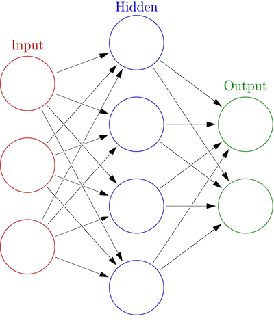
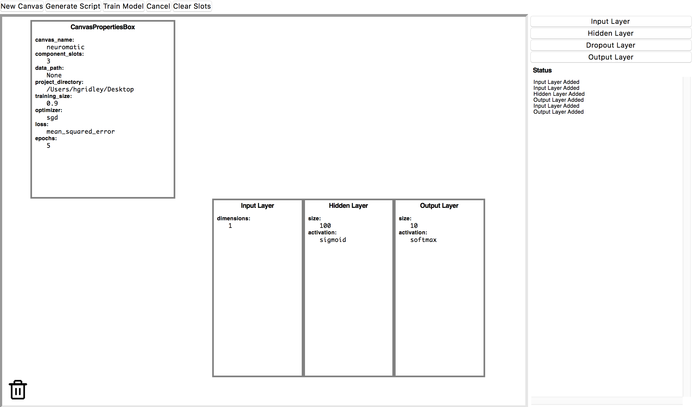
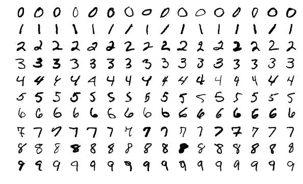

# Neuromatic

Neuromatic is a neural network visualization and prototyping tool built using Keras and TKinter.

The goal of this application is to enable developers, with minimal machine learning experience, to design and build
neural networks. A user can implement and train a simple neural network, similar to the network pictured below, using
this application. **This application is supported on Unix based operating systems**.



## Setup
### Installation
**Requires:**
* Python 3.6
* pip3

**Install:**
* Download from GitHub
* `cd path/to/Neuromatic`
* `python3 setup.py install`

**If errors occur during installation, run:**
* `pip3 install --upgrade tensorflow`
* `python3 setup.py install`

**Run the application:**
* `cd path/to/Neuromatic`
* `python3 Neuromatic.py`

## Usage



### Canvas Properties Box
Click the Canvas Properties Box, at the top left of the canvas, to open the properties editor. Click OK to save
properties.

**Canvas Name**

Project files will be saved to this name, using a different file extension depending on the file type.

**Number of Component Slots**

The number of component slots that exist on the canvas. (3-10)

**Training Data Path**

User specified path to the data on which the model will be trained. (CSV)

**Project Directory**

The directory to which all project files will be saved. Project files will take on the name specified by Canvas Name.

**Training Size**

The proportion of training data to test data, in the training data file, that the application will use to train the
model and test its accuracy.

**Optimizer**

**Loss**

**Epochs**

Number of times the training data will run through the neural network. Increasing the number of Epochs increases the
accuracy of the model, but also increases training time.

### Layers
A layer can be clicked and dragged from the top right of the application window and dropped on an empty slot on the
canvas to add the layer to the neural network design. Left clicking a layer on the canvas will open a properties editor
box.

**Input Layer**

**Output Layer**

**Hidden Layer**

**Dropout Layer**

If you would like to use existing training data A
test csv file is located in the `files` folder, simply unzip it, and point to it in the training data path. The project
directory path will be the location of all output files which include the canvas property pkl file, the python script,
and the h5 trained model file. Once the project properties are set, click okay to update the canvas. 

Next, to create a neural network, drag and drop the layer types on the right side onto slots in the canvas. If you wish
to edit layer properties simply click the layer on the canvas to edit its properties. To delete individual layers drag
them from the canvas to the trash icon. To clear all slots click the top clear slots button. To set all canvas
properties to default press the new canvas button. To open a saved canvas simply click file->open and select the pkl
file you wish to load. A well-functioning neural network .pkl configuration can be found in the file folder, just be
sure to change the project directory and csv location in project properties. Be sure that the input dimensions
correspond to the number of features in the csv file. For the Mnist data set this input dimension is 784.

Once you have a satisfactory neural network designed, click the generate button. This will create a python script in
the project directory which can be externally used to create the neural network. After a script is generated you can
train the model by clicking the train model button at the top, and can cancel it at any time by clicking the top cancel
button. The trained model will be saved to the selected directory for use outside of the program.

## Data
A CSV formatted version of the MNIST dataset (example shown below) is included with this project under
`neuromatic/files/mnist.csv.zip`. All data must be pre-processed to match the csv format. 



## Examples
These are two baseline networks manually built using Keras and TensorFlow. Running the scripts trains them on the MNIST
dataset and displays their accuracy.

```bash
python -m examples.keras_baseline
python -m examples.tf_baseline
```

After building a network, you can test it on some custom hand-written numbers by running
```bash
python -m examples.number_prediction
```
